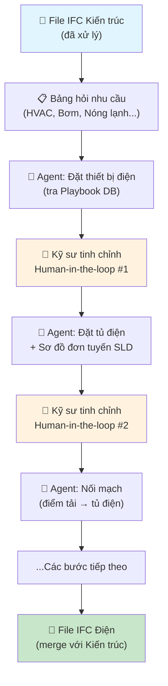
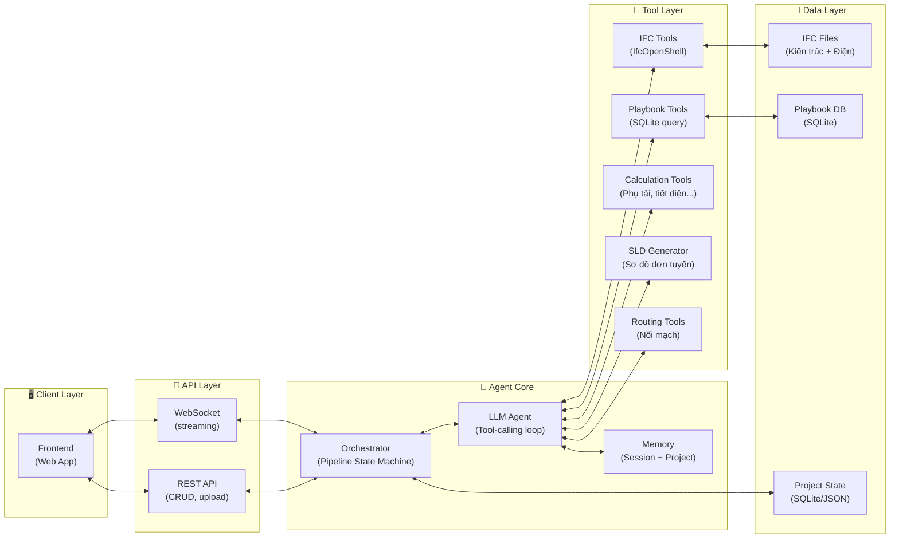
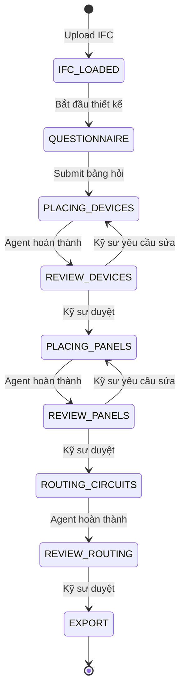
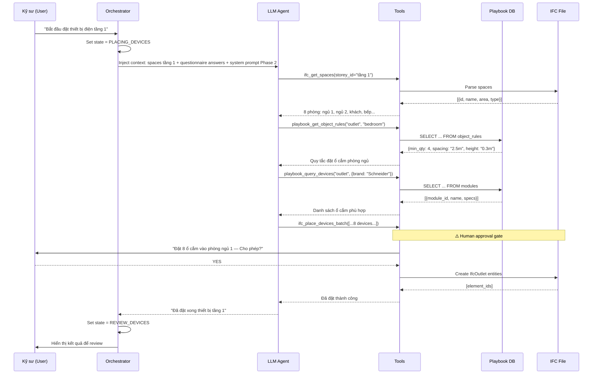

# 🏗️ Kiến trúc Backend — Hệ thống AI Tự động Thiết kế Điện từ IFC

## 1. Tổng quan luồng thiết kế (Pipeline)



---

## 2. Kiến trúc hệ thống tổng thể

> [!IMPORTANT]
> Nguyên tắc: **Agent đơn giản trước** — 1 Agent loop duy nhất, tools mạnh, context rõ ràng. Khi cần mới tách thành multi-agent.



---

## 3. Tư vấn giao thức Client ↔ Backend

Bạn chưa quyết định về giao thức, đây là khuyến nghị:

| Phương án | Ưu điểm | Nhược điểm | Khuyến nghị |
|-----------|---------|------------|-------------|
| **REST + WebSocket** | Streaming câu trả lời realtime, upload file qua REST, trạng thái pipeline qua WS | Phức tạp hơn REST thuần | ✅ **Khuyến nghị** |
| REST thuần | Đơn giản | Không stream được, user phải chờ → UX kém | ❌ |
| REST + SSE | Đơn giản hơn WS, stream 1 chiều | Không 2 chiều (user không cancel/interact mid-stream) | 🔶 OK tạm |

> [!TIP]
> **Khuyến nghị: FastAPI + WebSocket**
> - REST endpoints cho: upload IFC, lưu/load project, CRUD playbook, submit bảng hỏi
> - WebSocket cho: streaming câu trả lời Agent, gửi câu hỏi, nhận trạng thái pipeline realtime
> - FastAPI hỗ trợ cả hai natively, không cần thêm lib

---

## 4. Chi tiết từng layer

### 4.1. Orchestrator — Pipeline State Machine

Orchestrator quản lý **trạng thái quy trình thiết kế** — KHÔNG phải LLM, mà là code cứng điều phối luồng.



**Tại sao cần Orchestrator tách riêng?**
- LLM Agent chỉ biết "gọi tool, trả lời câu hỏi" — nó không nên quyết định khi nào chuyển sang bước tiếp theo
- Orchestrator giữ state, biết kỹ sư đã duyệt hay chưa, và inject đúng context + system prompt cho từng phase
- Khi kỹ sư sửa lại → Orchestrator quay state về đúng bước, cập nhật diff, cho Agent context mới

**State được lưu ở đâu?** → SQLite table `project_state` hoặc JSON file per project.

---

### 4.2. Agent Core — Tool-Calling Loop

Đây là LLM Agent loop chính, tương tự `IFCAgent.ask()` hiện tại nhưng được nâng cấp:

```
┌─────────────────────────────────────────────────┐
│                  Agent Loop                      │
│                                                  │
│  1. Nhận context từ Orchestrator                 │
│     (system prompt + phase-specific instructions │
│      + IFC summary + questionnaire answers       │
│      + playbook subset)                          │
│                                                  │
│  2. User message → LLM                           │
│                                                  │
│  3. LLM trả về tool_calls?                       │
│     ├─ YES → Execute tools → feed results → (3)  │
│     └─ NO  → Return answer to Orchestrator       │
│                                                  │
│  Write operations → Human approval gate          │
│                                                  │
└─────────────────────────────────────────────────┘
```

**System prompt thay đổi theo phase:**
- Phase `PLACING_DEVICES`: prompt chuyên về đặt ổ cắm, công tắc, đèn
- Phase `PLACING_PANELS`: prompt chuyên về tủ điện, SLD
- Phase `ROUTING_CIRCUITS`: prompt chuyên về nối mạch, tiết diện dây

**Tại sao 1 Agent là đủ (ban đầu)?**
- Tools đủ mạnh thì 1 Agent loop + context switching qua Orchestrator là đủ
- Multi-agent chỉ cần khi: (a) mỗi phase có quá nhiều tools (>30) gây confusion cho LLM, hoặc (b) cần parallel execution

---

### 4.3. Memory

| Loại | Mục đích | Storage |
|------|----------|---------|
| **Session Memory** | Lịch sử chat trong 1 phiên (đã có) | In-memory + SQLite |
| **Project Memory** | Trạng thái thiết kế: thiết bị đã đặt, tủ điện, mạch | SQLite `project_state` |
| **Playbook Memory** | Catalog thiết bị, quy tắc, load classes | SQLite `playbook.db` (read-only) |
| **User Preferences** | Tiêu chuẩn thiết kế, thói quen chọn thiết bị | SQLite `memory` (key-value, đã có) |

---

## 5. 🔧 Thiết kế Tools theo từng Phase

> [!IMPORTANT]
> Đây là phần quan trọng nhất. Mỗi tool là một hàm Python mà Agent có thể gọi. Tools phải **nguyên tử** (atomic), **có schema rõ ràng**, và **trả kết quả có cấu trúc**.

### Phase 0: IFC Reading & Understanding (Đã có một phần từ ifcMCP)

| # | Tool Name | Mô tả | Input | Output |
|---|-----------|--------|-------|--------|
| 1 | `ifc_get_storeys` | Lấy danh sách tầng | — | `[{id, name, elevation}]` |
| 2 | `ifc_get_spaces` | Lấy danh sách phòng/không gian theo tầng | `storey_id` | `[{id, name, type, area, long_name}]` |
| 3 | `ifc_get_space_geometry` | Lấy bounding box / polygon của phòng | `space_id` | `{bbox, polygon_2d, centroid}` |
| 4 | `ifc_get_space_adjacency` | Phòng nào kề phòng nào (qua tường/cửa) | `space_id` | `[{neighbor_id, shared_boundary_type}]` |
| 5 | `ifc_get_doors_windows` | Lấy cửa/cửa sổ trong phòng | `space_id` | `[{id, type, position, width}]` |
| 6 | `ifc_get_building_summary` | Tổng quan tòa nhà: số tầng, diện tích, công năng | — | `{storeys, total_area, building_type}` |
| 7 | `ifc_search_elements` | Tìm element theo type/property | `ifc_class, filters` | `[{id, type, location}]` |

### Phase 1: Bảng hỏi nhu cầu (Questionnaire)

| # | Tool Name | Mô tả | Input | Output |
|---|-----------|--------|-------|--------|
| 8 | `questionnaire_get_template` | Lấy mẫu bảng hỏi theo loại công trình | `building_type` | `{questions: [{id, text, options, multi_select}]}` |
| 9 | `questionnaire_submit` | Lưu kết quả bảng hỏi | `{answers: [{q_id, selected}]}` | `{status, derived_load_context}` |
| 10 | `questionnaire_get_load_context` | Lấy context phụ tải đã tính từ bảng hỏi | — | `{hvac, water_heater, pump, ...per_space_loads}` |

### Phase 2: Đặt thiết bị điện (Device Placement)

| # | Tool Name | Mô tả | Input | Output |
|---|-----------|--------|-------|--------|
| 11 | `playbook_query_devices` | Tra cứu thiết bị từ playbook DB | `category, filters` | `[{module_id, name, specs, load_W}]` |
| 12 | `playbook_get_load_class` | Lấy load class cho loại phòng/thiết bị | `space_type, device_category` | `{class, demand_factor, diversity}` |
| 13 | `playbook_get_object_rules` | Lấy quy tắc đặt thiết bị | `device_type, space_type` | `{min_qty, placement_rules, height, spacing}` |
| 14 | `ifc_place_device` | Đặt 1 thiết bị điện vào IFC | `device_type, space_id, position, properties` | `{new_element_id, status}` |
| 15 | `ifc_place_devices_batch` | Đặt nhiều thiết bị cùng lúc (cho Agent gọi 1 lần) | `[{device_type, space_id, position, ...}]` | `[{element_id, status}]` |
| 16 | `ifc_list_placed_devices` | Liệt kê thiết bị điện đã đặt | `storey_id / space_id` | `[{id, type, space, position, load_W}]` |
| 17 | `ifc_remove_device` | Xóa thiết bị đã đặt | `element_id` | `{status}` |
| 18 | `ifc_move_device` | Di chuyển thiết bị | `element_id, new_position` | `{status}` |
| 19 | `calc_space_load_summary` | Tính tổng phụ tải 1 phòng | `space_id` | `{total_W, device_count, breakdown}` |
| 20 | `calc_storey_load_summary` | Tính tổng phụ tải 1 tầng | `storey_id` | `{total_W, per_space, peak_demand}` |

### Phase 3: Đặt tủ điện + Sơ đồ đơn tuyến (Panel + SLD)

| # | Tool Name | Mô tả | Input | Output |
|---|-----------|--------|-------|--------|
| 21 | `playbook_query_panels` | Tra cứu tủ điện từ playbook | `capacity_range, type` | `[{panel_id, name, max_circuits, rated_A}]` |
| 22 | `playbook_query_breakers` | Tra cứu thiết bị đóng cắt | `rated_A, type` | `[{breaker_id, name, rated_A, breaking_capacity}]` |
| 23 | `ifc_place_panel` | Đặt tủ điện vào IFC | `panel_type, storey_id, position, properties` | `{element_id, status}` |
| 24 | `panel_assign_circuits` | Gán thiết bị/nhóm thiết bị vào circuit của tủ | `panel_id, [{circuit_no, device_ids, breaker_id}]` | `{status, updated_panel}` |
| 25 | `panel_get_schedule` | Lấy bảng phân phối tải của tủ | `panel_id` | `{circuits: [{no, name, devices, load_W, breaker}]}` |
| 26 | `sld_generate` | Sinh sơ đồ đơn tuyến từ cấu hình tủ | `panel_id` | `{sld_svg, sld_data}` |
| 27 | `sld_generate_building` | Sinh SLD tổng thể toàn tòa nhà | — | `{sld_svg, hierarchy}` |
| 28 | `calc_panel_sizing` | Tính toán chọn tủ phù hợp | `total_load_W, circuit_count` | `{recommended_panel, rated_A, headroom_%}` |
| 29 | `calc_breaker_sizing` | Tính toán chọn CB/MCB | `load_W, cable_type, length` | `{recommended_breaker, rated_A}` |

### Phase 4: Nối mạch (Circuit Routing)

| # | Tool Name | Mô tả | Input | Output |
|---|-----------|--------|-------|--------|
| 30 | `playbook_query_cables` | Tra cứu cáp/dây từ playbook | `current_A, voltage, material` | `[{cable_id, name, cross_section, ampacity}]` |
| 31 | `playbook_get_terminal_class` | Lấy terminal class cho kết nối | `connection_type` | `{terminal_class, specs}` |
| 32 | `route_calculate_path` | Tính đường đi tối ưu từ thiết bị đến tủ | `device_id, panel_id` | `{path_points, length_m, via_conduit}` |
| 33 | `route_calculate_cable_size` | Tính tiết diện dây theo tải + chiều dài | `load_W, length_m, voltage, method` | `{cross_section_mm2, voltage_drop_%}` |
| 34 | `ifc_create_circuit` | Tạo mạch điện trong IFC | `{panel_id, circuit_no, device_ids, cable_spec, path}` | `{circuit_id, status}` |
| 35 | `ifc_create_circuits_batch` | Tạo nhiều mạch cùng lúc | `[{panel_id, circuit_no, ...}]` | `[{circuit_id, status}]` |
| 36 | `ifc_list_circuits` | Liệt kê mạch đã tạo | `panel_id` | `[{circuit_id, devices, cable, length}]` |
| 37 | `calc_voltage_drop` | Kiểm tra sụt áp | `circuit_id` | `{drop_V, drop_%, pass_fail}` |
| 38 | `calc_total_cable_schedule` | Bảng kê cáp tổng | — | `{cables: [{type, total_length_m, qty}]}` |

### Cross-phase Utility Tools

| # | Tool Name | Mô tả | Input | Output |
|---|-----------|--------|-------|--------|
| 39 | `ifc_save_electrical` | Lưu file IFC điện | `output_path` | `{status, file_size}` |
| 40 | `ifc_merge_with_arch` | Merge IFC điện vào IFC kiến trúc | `arch_path, elec_path` | `{merged_path, status}` |
| 41 | `ifc_validate_electrical` | Kiểm tra tính hợp lệ model điện | — | `{errors: [], warnings: []}` |
| 42 | `project_get_state` | Lấy trạng thái project hiện tại | — | `{phase, progress, last_action}` |
| 43 | `project_get_diff` | Xem thay đổi so với lần kỹ sư duyệt trước | — | `{added, modified, removed}` |

---

## 6. Kiến trúc Code sơ bộ (Package Layout)

```
electrical-design-agent/
├── api/                        # FastAPI endpoints
│   ├── routes/
│   │   ├── project.py          # Upload IFC, CRUD project
│   │   ├── questionnaire.py    # Bảng hỏi
│   │   ├── agent.py            # Chat endpoint (WS + REST)
│   │   └── review.py           # Kỹ sư duyệt/sửa
│   └── websocket.py            # WS handler
│
├── agent/                      # Agent core
│   ├── orchestrator.py         # Pipeline state machine
│   ├── agent.py                # LLM tool-calling loop
│   ├── prompts/                # System prompts per phase
│   │   ├── phase_devices.py
│   │   ├── phase_panels.py
│   │   └── phase_routing.py
│   └── context_builder.py      # Build context cho mỗi phase
│
├── tools/                      # Tất cả tools Agent gọi được
│   ├── ifc_read.py             # Tools đọc IFC (Phase 0)
│   ├── ifc_write.py            # Tools ghi IFC (đặt thiết bị, tủ, mạch)
│   ├── playbook.py             # Tools tra cứu playbook DB
│   ├── calculation.py          # Tools tính toán điện
│   ├── sld_generator.py        # Tools sinh sơ đồ đơn tuyến
│   └── routing.py              # Tools tính đường đi mạch
│
├── llm/                        # LLM providers (đã có)
│   ├── base.py
│   ├── factory.py
│   ├── gemini_provider.py
│   ├── openai_provider.py
│   └── groq_provider.py
│
├── database/
│   ├── playbook.db             # Playbook SQLite (bạn chuẩn bị)
│   └── project_store.py        # CRUD project state
│
├── ifc_engine/                 # IfcOpenShell wrapper
│   ├── reader.py               # Parse IFC, lấy spaces, geometry
│   ├── writer.py               # Tạo/sửa IFC entities
│   ├── merger.py               # Merge IFC files
│   └── validator.py            # Validate IFC model
│
├── memory/
│   ├── session.py              # Chat history
│   └── project.py              # Project-level state
│
└── config/
    ├── settings.py             # App config
    └── standards.py            # Tiêu chuẩn điện VN (TCVN, IEC)
```

---

## 7. Luồng dữ liệu chi tiết cho 1 Phase (ví dụ Phase 2: Đặt thiết bị)



---

## 8. Các quyết định kiến trúc quan trọng

### 8.1 Tại sao IfcOpenShell thay vì ifcMCP?

| Tiêu chí | ifcMCP (qua MCP protocol) | IfcOpenShell (trực tiếp) |
|-----------|--------------------------|-------------------------|
| **Đọc IFC** | ✅ Tốt, nhiều tool sẵn | ✅ Tốt, toàn quyền |
| **Ghi IFC** (tạo entity mới) | ⚠️ Chỉ có `ifc_edit`, `ifc_shape` | ✅ Toàn quyền: `create_entity()`, `add_rel()` |
| **Tạo hệ thống điện** | ❌ Không có tool chuyên biệt | ✅ Tự viết: `IfcDistributionPort`, `IfcCircuit`, `IfcElectricalCircuit` |
| **Performance** | ⚠️ JSON over stdio, overhead | ✅ In-process, nhanh |
| **Phụ thuộc** | External process | Pip package |

> [!NOTE]
> Bạn vẫn có thể **giữ ifcMCP cho phần đọc/hỏi đáp** (vì các tool đọc của nó khá tốt), và dùng **IfcOpenShell trực tiếp cho phần ghi** (đặt thiết bị, tủ, mạch). Đó là hybrid approach nếu muốn giảm công sức viết tool đọc.

### 8.2 Tại sao Pipeline State Machine chứ không để Agent tự điều phối?

- **Deterministic**: Quy trình thiết kế điện có thứ tự bắt buộc (đặt thiết bị → tủ → mạch). LLM không nên quyết định thứ tự này.
- **Human-in-the-loop**: Kỹ sư PHẢI duyệt giữa mỗi phase. State machine đảm bảo không bỏ qua.
- **Resumable**: Nếu kỹ sư đóng trình duyệt, state lưu trong DB → mở lại từ đúng chỗ.
- **Auditable**: Mỗi transition được log → dễ trace lỗi.

### 8.3 Tool đăng ký với Agent như thế nào?

```python
# Mỗi phase chỉ expose tools cần thiết → LLM ít bị confused
PHASE_TOOLS = {
    "PLACING_DEVICES": [
        "ifc_get_storeys",
        "ifc_get_spaces",
        "ifc_get_space_geometry",
        "ifc_get_doors_windows",
        "playbook_query_devices",
        "playbook_get_object_rules",
        "playbook_get_load_class",
        "ifc_place_device",
        "ifc_place_devices_batch",
        "ifc_list_placed_devices",
        "ifc_remove_device",
        "ifc_move_device",
        "calc_space_load_summary",
        "calc_storey_load_summary",
    ],
    "PLACING_PANELS": [
        "ifc_get_storeys",
        "ifc_list_placed_devices",
        "playbook_query_panels",
        "playbook_query_breakers",
        "ifc_place_panel",
        "panel_assign_circuits",
        "panel_get_schedule",
        "sld_generate",
        "sld_generate_building",
        "calc_panel_sizing",
        "calc_breaker_sizing",
        "calc_storey_load_summary",
    ],
    "ROUTING_CIRCUITS": [
        "ifc_list_placed_devices",
        "ifc_list_circuits",
        "playbook_query_cables",
        "playbook_get_terminal_class",
        "route_calculate_path",
        "route_calculate_cable_size",
        "ifc_create_circuit",
        "ifc_create_circuits_batch",
        "calc_voltage_drop",
        "calc_total_cable_schedule",
    ],
}
```

---

## 9. Lộ trình phát triển đề xuất

```mermaid
flowchart LR
    subgraph P1["Phase 1 (MVP)\n4-6 tuần"]
        A1["IFC Read Tools\n(IfcOpenShell)"]
        A2["Playbook DB\n+ Query Tools"]
        A3["Agent Loop\n(1 Agent, đặt thiết bị)"]
        A4["CLI interface\n(chưa cần FE)"]
    end

    subgraph P2["Phase 2\n3-4 tuần"]
        B1["Orchestrator\n(State Machine)"]
        B2["Tủ điện Tools\n+ SLD Generator"]
        B3["Calculation Tools"]
        B4["FastAPI + WS"]
    end

    subgraph P3["Phase 3\n3-4 tuần"]
        C1["Routing Tools\n(nối mạch)"]
        C2["IFC Merge/Export"]
        C3["Validation"]
        C4["Frontend MVP"]
    end

    subgraph Future["Tương lai"]
        D1["Multi-agent\n(nếu cần)"]
        D2["Self-improving\n(feedback loop)"]
        D3["Mở rộng\nquy mô CT"]
    end

    P1 --> P2 --> P3 --> Future
```



> [!WARNING]
> **Phase 1 nên chạy CLI trước**, không cần đầu tư Frontend sớm. Validate rằng Agent + Tools hoạt động đúng trên 2-3 file IFC nhà dân thực tế, sau đó mới wrap API + Frontend.

---

## 10. Tổng kết Tools

| Phase | Số tools | Loại | Độ phức tạp |
|-------|---------|------|-------------|
| Phase 0: IFC Reading | 7 | Read-only | 🟢 Thấp-TB |
| Phase 1: Questionnaire | 3 | Logic | 🟢 Thấp |
| Phase 2: Device Placement | 10 | Read + Write IFC + Calc | 🟡 TB |
| Phase 3: Panel + SLD | 9 | Write IFC + Generate SVG + Calc | 🔴 Cao |
| Phase 4: Routing | 9 | Write IFC + Pathfinding + Calc | 🔴 Cao |
| Utility | 5 | Save/Merge/Validate | 🟡 TB |
| **Tổng** | **~43 tools** | | |

> [!CAUTION]
> 43 tools là nhiều cho 1 Agent. Nhưng vì mỗi phase chỉ expose ~12-15 tools → LLM hoàn toàn handle được. Đây chính là lý do cần Orchestrator để switch tool sets theo phase.
