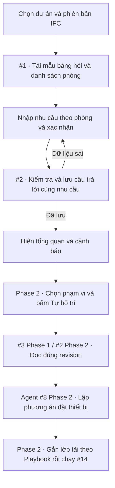

# Phase 1 — Bảng hỏi nhu cầu sử dụng điện

Phase 1 chuyển câu trả lời của người dùng thành danh sách nhu cầu có ID ổn định, gắn với phòng trong IFC. Đầu ra dùng cho Agent lập phương án ở Phase 2 và làm nguồn công suất khai báo cho tool tính tải sơ bộ. Phase 1 dùng ba tool backend và các quy tắc chuyển đổi theo mẫu bảng hỏi đã lưu phiên bản.

## Bảng tick theo IFC và Playbook

Bản web và terminal dùng chung API. Phòng ngủ, phòng khách và bếp có tùy chọn
điều hòa, bếp mặc định 0. WC có bình nước nóng và tùy chọn dùng chung theo tầng.
Bảng tick lưu bếp gas/điện, số mặt bếp, lò nướng, tủ lạnh, máy bơm và phòng đặt máy giặt.
Thiết bị tùy chỉnh được lưu vào Playbook PostgreSQL. Chọn nhóm để tra min/max,
có thể nhập W thực tế. Phase 2 nhận các mục đã tick và yêu cầu bố trí tự động.

Code bảng hỏi, cấu hình, lưu trữ, API và HTML nằm trong `tools/phase1`.
Xem [hướng dẫn chạy bảng tick](docs/questionnaire_checklist_api.md#chạy-và-thử).
Các mục dưới đây mô tả hợp đồng nhập tay và bàn giao nhu cầu sang Phase 2.

## 1. Luồng sử dụng



Giao diện bắt đầu bằng danh sách tầng và phòng lấy từ IFC. Người dùng chọn phòng, trả lời, xem lại số lượng, công suất và các mục còn thiếu, rồi bấm **Lưu nhu cầu**. Có thể tiếp tục với các phòng đã xác nhận. Khi chọn **Tự bố trí**, giao diện truyền revision vừa lưu và danh sách phòng mục tiêu. Nhu cầu còn thiếu phòng hiển thị riêng để người dùng bổ sung.

MVP hỗ trợ nhà phố với các nhóm câu hỏi gồm chiếu sáng và điểm cấp điện, thiết bị cắm điện đã biết, điều hòa và thông gió, bình nước nóng, bơm và thiết bị riêng. API MVP trả danh sách nhóm câu hỏi. UI có thể chọn nhóm hiển thị khi đã xác nhận loại phòng. Mỗi nhóm có ba lựa chọn **Có nhu cầu**, **Không cần** và **Chưa rõ**. Khi chọn **Có nhu cầu**, người dùng có thể thêm nhiều dòng thiết bị, chọn phòng, nhập số lượng, công suất điện mỗi thiết bị và nguồn số liệu. Ghi chú vị trí như “gần bàn làm việc” là ưu tiên bố trí. Hình học và tọa độ lấy từ IFC trong Phase 2.

## 2. Ba tool và hợp đồng dữ liệu

### #1 · `questionnaire_get_template`

**Input** gồm `project_id`, `building_type` và `model_revision`. Backend chọn mẫu đã phát hành theo loại công trình và đọc phòng/tầng từ chỉ mục IFC của dự án.

**Output** gồm `template_id`, `template_version`, `model_revision`, `questions[]` và `spaces[]`. Mỗi câu hỏi có `q_id`, `text`, `type`, `options` nếu có, và quy tắc hiển thị nếu phụ thuộc câu trả lời khác. Mỗi phòng có `space_id` bằng `IfcSpace.GlobalId`, tên hiển thị và `storey_id` nếu có. ID là khóa lưu dữ liệu kể cả khi hai phòng trùng tên.

Ví dụ một câu hỏi trong mẫu `townhouse-electrical`, phiên bản `1`.

```json
{
  "q_id": "desk_equipment",
  "text": "Phòng có thiết bị dùng điện tại bàn làm việc không?",
  "type": "single_select",
  "options": [
    {"id": "needed", "label": "Có nhu cầu"},
    {"id": "not_needed", "label": "Không cần"},
    {"id": "unknown", "label": "Chưa rõ"}
  ],
  "follow_up_fields": ["space_id", "quantity", "input_W", "input_VA", "power_source", "placement_hint"]
}
```

### #2 · `questionnaire_submit`

**Input** gồm `project_id`, `template_id`, `template_version`, `model_revision`, `expected_revision` và `answers[]`. `expected_revision: 0` dùng cho lần lưu đầu. `answers` là bản đầy đủ đang chỉnh. UI giữ câu trả lời của các phòng khác khi lưu thay đổi một phòng. Mỗi dòng nhu cầu có `answer_item_id` riêng và được giữ lại khi chỉnh số lượng, công suất hoặc ghi chú.

Ví dụ phần `answers` cho revision 2. Người dùng đổi thiết bị bàn làm việc từ 1 × 120 W thành 2 × 150 W và khai có một bình nước nóng nhưng chưa biết công suất.

```json
[
  {
    "answer_item_id": "desk-01",
    "q_id": "desk_equipment",
    "space_id": "12bXDOM85FnBBK679nyVuK",
    "selected": "needed",
    "quantity": 2,
    "input_W": 150,
    "power_source": "Công suất đầu vào trên nhãn thiết bị do người dùng cung cấp",
    "placement_hint": "Gần bàn làm việc"
  },
  {
    "answer_item_id": "heater-01",
    "q_id": "water_heater",
    "space_id": "12bXDOM85FnBBK679nyVuO",
    "selected": "needed",
    "quantity": 1
  }
]
```

Backend kiểm tra dự án, phiên bản mẫu và IFC, mã câu hỏi/lựa chọn, phòng và ID dòng. Số lượng đã khai phải là số nguyên dương. W và VA là công suất điện đầu vào **của một thiết bị**, phải hữu hạn, không âm và có nguồn khi có số. Nếu bổ sung PF thì dùng giá trị trong khoảng `(0, 1]` và lưu `pf_source`. Kiểm tra nhất quán W/VA/PF bằng cùng quy tắc với #14. Khi thiếu công suất hoặc số lượng, giữ `null` và trả cảnh báo theo nhu cầu. `not_needed` được lưu trong câu trả lời và loại khỏi nhu cầu đang hoạt động. `unknown` giữ trạng thái chưa xác nhận, khác với câu bỏ trống và với lựa chọn `not_needed`.

**Output khi thành công** gồm `status`, `questionnaire_revision`, `warnings` và có thể kèm `derived_load_context` cùng cấu trúc với kết quả #3 để UI hiển thị ngay. Ví dụ rút gọn khi bỏ phần context.

```json
{
  "status": "saved",
  "questionnaire_revision": 2,
  "warnings": [
    {"code": "UNKNOWN_INPUT_POWER", "requirement_id": "req-wc-heater", "space_id": "12bXDOM85FnBBK679nyVuO"}
  ]
}
```

### #3 · `questionnaire_get_load_context`

**Input** gồm `project_id`, `space_id` tùy chọn và `questionnaire_revision` tùy chọn. Nếu bỏ `space_id`, trả toàn dự án. Nếu bỏ revision, trả revision mới nhất đã lưu. Khi chạy Phase 2, Orchestrator dùng revision cụ thể đã chọn cho lần chạy đó. UI có thể gửi `include_answers=true` để mở lại các câu trả lời đã lưu.

**Output** là nhu cầu chuẩn hóa của revision đã lưu. Mỗi mục có `requirement_id`, `space_id`, `device_category`, `intent` (`equipment` hoặc `supply_point`), `quantity`, dữ liệu công suất mỗi đơn vị nếu có, ghi chú vị trí và nguồn từ bảng hỏi. `unresolved_requirements` chứa nhu cầu chưa thể gắn phòng. Khi lọc theo phòng, trả nhu cầu và cảnh báo của phòng đó cùng cảnh báo cấp dự án có liên quan. Các mục chưa có phòng xem ở kết quả toàn dự án.

```json
{
  "status": "ok",
  "project_id": "demo-house",
  "model_revision": "demo-ifc-revision",
  "questionnaire_revision": 2,
  "requirements": [
    {
      "requirement_id": "req-bedroom-desk",
      "space_id": "12bXDOM85FnBBK679nyVuK",
      "device_category": "desk_equipment",
      "intent": "equipment",
      "quantity": 2,
      "input_W": 150,
      "input_VA": null,
      "power_factor": null,
      "power_source": "Công suất đầu vào trên nhãn thiết bị do người dùng cung cấp",
      "placement_hint": "Gần bàn làm việc",
      "source_answer_item_id": "desk-01"
    },
    {
      "requirement_id": "req-wc-heater",
      "space_id": "12bXDOM85FnBBK679nyVuO",
      "device_category": "water_heater",
      "intent": "equipment",
      "quantity": 1,
      "input_W": null,
      "input_VA": null,
      "power_factor": null,
      "source_answer_item_id": "heater-01"
    }
  ],
  "unresolved_requirements": [],
  "warnings": [
    {"code": "UNKNOWN_INPUT_POWER", "requirement_id": "req-wc-heater", "space_id": "12bXDOM85FnBBK679nyVuO"}
  ]
}
```

Chưa từng gửi bảng hỏi trả `status: "not_submitted"`. Đã gửi và xác nhận không có nhu cầu có thể trả `status: "ok"` với mảng rỗng. Revision hoặc phòng được chỉ định mà không tồn tại trả lỗi rõ ràng để backend xử lý.

### Dữ liệu thiếu và dữ liệu sai

Các trường tùy chọn nhận `null` hoặc được bỏ qua khi chưa biết. Backend cũng
chuẩn hóa chuỗi trống ở nguồn công suất, nguồn PF và ghi chú thành thông tin thiếu.
Chuỗi tùy ý ở trường số, số âm, số không hữu hạn, số lượng không nguyên dương,
PF ngoài (0, 1] hoặc W/VA/PF mâu thuẫn vẫn bị từ chối.

Terminal cung cấp lựa chọn nhập, chưa biết và giữ giá trị cũ. Dữ liệu nhập sai
được hỏi nhập lại hay đánh dấu chưa biết; không dùng danh sách từ đồng nghĩa.
Nguồn công suất và nguồn PF có thể bổ sung sau. Khi có giá trị nhưng thiếu nguồn,
Phase 1 vẫn lưu, giữ ID nhu cầu và trả `MISSING_POWER_SOURCE` / `MISSING_PF_SOURCE`.
Các cảnh báo này không có nghĩa thiết bị không cần điện.

Tool #14 giữ giá trị chưa có nguồn trong chi tiết nhưng không cộng vào tổng;
`coverage` thể hiện phần thiếu. PF thiếu nguồn không được dùng để quy đổi W/VA.
Không mặc định PF=1, không tự tạo nguồn hay tự chọn công suất từ Playbook.
Người dùng bổ sung nguồn rồi tính lại để cập nhật kết quả. Nguồn dạng văn bản
là khai báo của người dùng, không phải chứng nhận đã xác minh.

## 3. Lưu dữ liệu và quản lý revision

PostgreSQL lưu một snapshot bất biến theo `project_id + questionnaire_revision`, chứa phiên bản mẫu và IFC, câu trả lời gốc, nhu cầu chuẩn hóa và cảnh báo. Mỗi lần lưu ghi cả snapshot trong một giao dịch. Backend tạo hoặc tra `requirement_id` theo dòng nguồn `answer_item_id` trong cùng dự án. Khi đổi số lượng hoặc công suất của dòng, ID được giữ nguyên. Khi xóa dòng rồi thêm một nhu cầu mới, cấp ID mới. Nếu đổi phòng hoặc nhóm thiết bị của cùng dòng, giữ ID để đối chiếu lịch sử và đưa liên kết bố trí cũ về kiểm tra.

Lưu lại cùng nội dung với cùng phiên bản mẫu và IFC trả revision hiện hành. Nếu nội dung đã đổi nhưng `expected_revision` cũ, trả xung đột và yêu cầu UI tải bản mới để đối chiếu. Các revision cũ vẫn đọc được cùng ID và phiên bản mẫu đã dùng. MVP phát hành mẫu nhà phố phiên bản 1. Sau khi thay IFC, kiểm tra lại từng `space_id` trước lần bố trí mới. Phòng biến mất cần được người dùng chọn lại và gửi revision mới. Một phương án đã lưu giữ revision bảng hỏi mà nó đã sử dụng. Gửi bảng hỏi mới tạo đầu vào để chạy lại hoặc kiểm tra phần bị ảnh hưởng của phương án.

## 4. Bàn giao sang Phase 2

1. Orchestrator gọi **#2 Phase 2**, chính là **#3 Phase 1** `questionnaire_get_load_context`. Agent **#8 Phase 2** nhận nhu cầu của phòng mục tiêu cùng dữ liệu IFC và Playbook. Agent chọn thiết bị và vị trí phù hợp. Khi số lượng chưa rõ, phương án cần ghi rõ nếu số lượng đề xuất đến từ quy tắc Playbook. Số lượng này cần được xác nhận trước khi coi nhu cầu đã được đáp ứng.
2. Phase 2 tra `load_class_id` qua **#5** và giữ `requirement_id` trong proposal. Với hai thiết bị của cùng nhu cầu, hai điểm tải dùng cùng ID yêu cầu và `requirement_unit` lần lượt là `1` và `2`. Thiết bị cắm điện và ổ cắm phục vụ nó là hai bản ghi khác nhau. Điểm ổ cắm giữ thông số đầu nối. Thiết bị sử dụng điện giữ công suất và liên kết `outlet_id` khi biết ổ phục vụ.
3. Khi tạo `ProjectSnapshot` cho **#14**, adapter đổi `space_id` thành `room_id`, bổ sung lớp tải thật và đưa nhu cầu có phòng, lớp tải và số lượng xác định vào `requirements`. Nhu cầu chỉ yêu cầu một điểm cấp điện được theo dõi trong phương án bố trí. Chỉ đưa điểm cấp điện vào tính tải nếu có bản ghi tải thiết bị hoặc suất tải có nguồn áp dụng cho điểm đó. Giữ cảnh báo cho mục chưa đủ dữ liệu ở kết quả bàn giao.
4. #14 hiện ghép điểm tải với yêu cầu qua ID, phòng, lớp tải và số thứ tự đơn vị. Một thiết bị chưa có W/VA có thể nhận công suất từ yêu cầu đã ghép. Nhu cầu đủ dữ liệu nhưng chưa có điểm đặt xuất hiện trong `pending_requirements`. Hai thiết bị 150 W đã đặt và ghép đúng đóng góp 300 W tải kết nối. Nhu cầu chưa đặt hoặc chưa biết W/VA cần được hiển thị riêng khi xem kết quả. Hệ số nhu cầu thuộc ruleset Playbook của #14.

Ví dụ record cho `ProjectSnapshot.requirements` sau khi #5 trả lớp tải `TẢI-005`, theo bộ dữ liệu mẫu của repo.

```json
{
  "requirement_id": "req-bedroom-desk",
  "room_id": "12bXDOM85FnBBK679nyVuK",
  "load_class_id": "TẢI-005",
  "quantity": 2,
  "input_W": 150,
  "power_source": "Công suất đầu vào trên nhãn thiết bị do người dùng cung cấp"
}
```

## 5. Kiểm thử nghiệm thu

- Tải mẫu bằng IFC `database/A.ifc`. Chọn P. NGỦ 02 và WC rồi kiểm tra ID lưu khớp `IfcSpace.GlobalId`.
- Gửi 1 × 120 W cho bàn làm việc, sau đó sửa thành 2 × 150 W. Kiểm tra revision tăng, `requirement_id` giữ nguyên, đọc lại được cả hai revision và lần gửi lại cùng nội dung không tạo thêm bản.
- Gửi dữ liệu với revision cũ, ID phòng sai, số lượng bằng 0 hoặc công suất có số mà thiếu nguồn. Kiểm tra trả đúng lỗi và không lưu một phần.
- Kiểm tra riêng ba trường hợp **Không cần**, **Chưa rõ** và bỏ trống. Nhu cầu bình nước nóng chưa biết công suất vẫn đọc được ở WC với cảnh báo. Khi lọc P. NGỦ 02, cảnh báo riêng của WC không đi theo.
- Kiểm tra nhu cầu chưa chọn phòng hiện trong `unresolved_requirements`. Sau khi gắn phòng, nhu cầu xuất hiện trong kết quả lọc phòng. Thay IFC và kiểm tra các phòng đã biến mất cần được xác nhận lại trước lần bố trí mới.
- Chạy Phase 2 với revision 2, ánh xạ bằng Playbook trong `database/`, rồi thử #14. Hai điểm thiết bị hợp lệ phải đóng góp 300 W. Nếu chỉ đặt một điểm, kết quả có 150 W từ nhu cầu bàn làm việc và còn một đơn vị trong `pending_requirements`. Kiểm tra riêng suất tải ổ cắm và số W đã biết để tránh cộng trùng.

Ba tool Python nằm trong [tools/phase1/questionnaire_get_template.py](tools/phase1/questionnaire_get_template.py), [tools/phase1/questionnaire_submit.py](tools/phase1/questionnaire_submit.py), [tools/phase1/questionnaire_get_load_context.py](tools/phase1/questionnaire_get_load_context.py) và được gọi qua [api/routes/questionnaire.py](api/routes/questionnaire.py). Có thể nhập trực tiếp trong Terminal qua `python -m tools.phase1.questionnaire_submit`. Lệnh chạy và file đầu vào mẫu nằm trong [README](README.md#phase-1-questionnaire). Phần điều phối bố trí theo [phase2_devices_placement.md](phase2_devices_placement.md).
